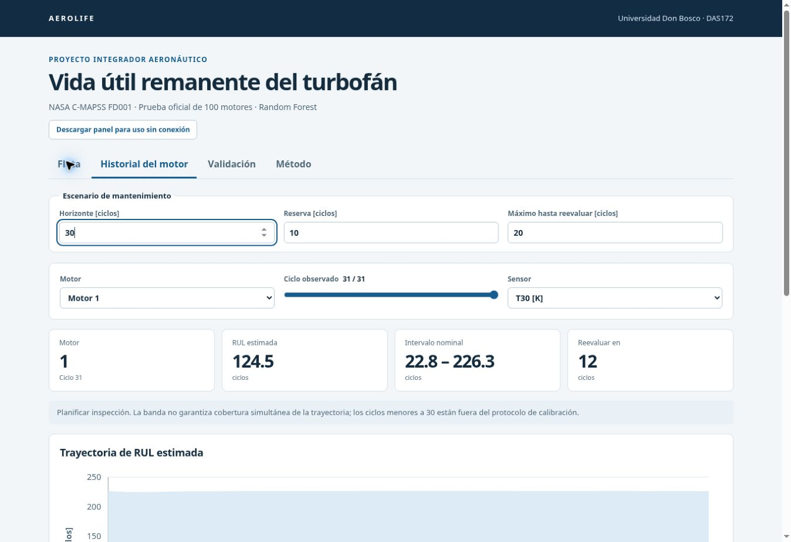

# AEROLIFE

**Predicción de vida útil remanente en motores turbofán**

Universidad Don Bosco · Desarrollo de Algoritmos para la Simulación de Sistemas (DAS172)

AEROLIFE estima los ciclos de vida útil remanente (RUL) a partir del historial de sensores de la flota NASA C-MAPSS FD001. El caso de estudio evalúa cómo incorporar esa estimación y su incertidumbre a la priorización de inspecciones boroscópicas ante degradación simulada del compresor de alta presión.

| Entregable | Acceso |
| --- | --- |
| Informe técnico | [Reporte_Tecnico_RUL_Turbofan.pdf](reports/Reporte_Tecnico_RUL_Turbofan.pdf) |
| Cuaderno de análisis | [pipeline_analitico.ipynb](notebooks/pipeline_analitico.ipynb) |
| Panel interactivo | [Abrir en el navegador](https://mauro0703.github.io/aerolife-panel-fd001/) · [Descargar ZIP](https://mauro0703.github.io/aerolife-panel-fd001/Panel_Interactivo_AEROLIFE.zip) |

## Panel interactivo



El ZIP ocupa menos de 0,5 MB. Para consultar el panel sin instalación, extraer su contenido en una carpeta y abrir `index.html` en un navegador actualizado. Incluye la priorización de la flota, el historial de ocho canales por motor, la validación del modelo y la exportación de resultados a CSV. Los controles de horizonte, reserva e intervalo máximo de reevaluación permiten comparar escenarios de planificación. [Copia del ZIP en el repositorio](dashboard/Panel_Interactivo_AEROLIFE.zip).

## Resultados del experimento

| Indicador en la prueba oficial FD001 | Resultado |
| --- | ---: |
| Motores evaluados | 100 |
| RMSE | 17,19 ciclos |
| MAE | 12,33 ciclos |
| R² | 0,829 |
| Cobertura empírica del intervalo conformal | 100 % |
| Anchura media del intervalo | 172,76 ciclos |

Se usaron 80 motores para desarrollar el modelo y 20 para calibrar el intervalo conformal. La selección comparó ocho candidatos mediante cinco particiones agrupadas por motor. El imputador, el selector de varianza y el escalador se ajustaron dentro de la partición de entrenamiento de cada ajuste. Las variables de entrada se calcularon con el historial disponible hasta el ciclo consultado. El modelo seleccionado fue Random Forest con un mínimo de tres observaciones por hoja.

FD001 simula un régimen de operación y una modalidad de degradación. La cobertura observada se interpreta junto con la anchura del intervalo. Los criterios del panel corresponden a escenarios de estudio y su aplicación en operación requiere validación con datos de servicio y procedimientos del fabricante.

## Ejecución del sistema

El entorno de referencia es Python 3.12. Desde la raíz del repositorio, con un entorno virtual activo, instalar las dependencias fijadas y ejecutar la aplicación.

```bash
python -m pip install -r requirements-lock.txt
python -m streamlit run app.py
```

La aplicación utiliza el modelo entrenado incluido en el repositorio y admite la carga de historiales CSV con el esquema de FD001. Las columnas y unidades se especifican en el [diccionario de datos](reports/DICCIONARIO_DATOS.md).

Para reproducir el ajuste, la evaluación y los datos del panel, ejecutar estos comandos desde la raíz del repositorio.

```bash
python scripts/run_pipeline.py
python scripts/export_dashboard.py
python -m pytest -q
```

El cuaderno ejecutado ofrece una ruta independiente del experimento. Si se requiere recuperar los archivos originales, `python scripts/download_data.py` descarga FD001 desde la fuente registrada en la [ficha de procedencia](data/raw/README.md).

## Organización del repositorio

| Ruta | Contenido |
| --- | --- |
| `data/raw/` y `data/processed/` | Datos FD001 originales, tablas depuradas y matrices transformadas |
| `src/rul/` y `scripts/` | Ingesta, características, entrenamiento, evaluación e inferencia |
| `models/` | Modelo serializado, metadatos y ficha técnica |
| `reports/` | Informe, figuras, métricas y evidencia del experimento |
| `notebooks/` | Cuaderno ejecutado del análisis |
| `dashboard/` y `app.py` | Panel de consulta y aplicación Streamlit |
| `tests/` | Pruebas de integridad, separación por motor, causalidad e inferencia |

## Integrantes

- Adriana Zaira Salazar Guzmán
- Marcela Lorena Martínez Linares
- Andrea Alejandra Mejía Martínez
- Diego Josué Hernández Martínez
- Mauro José Abarca Gómez
- Jaime Fernando Portillo Linares
- Emma Leticia Zelada Salamanca

**Docente** · Eduardo Galicia

[Referencias](reports/REFERENCIAS.md) · [Ficha del modelo](models/MODEL_CARD.md) · [Métricas del experimento](reports/metrics.json)
