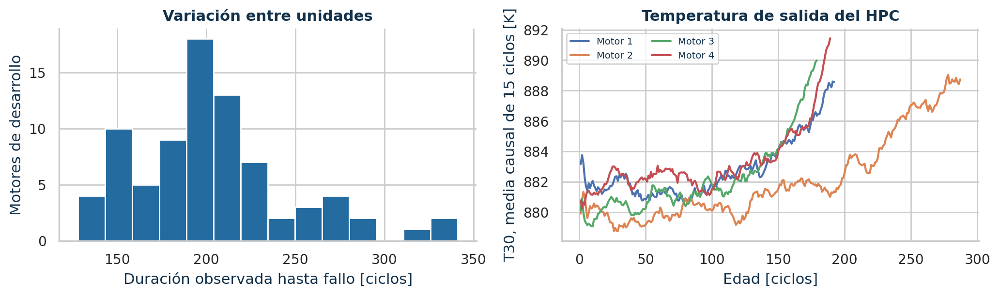
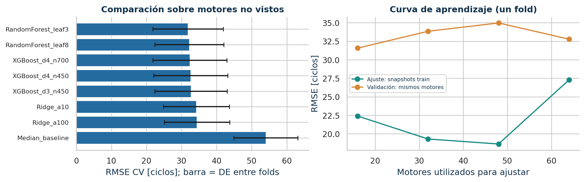
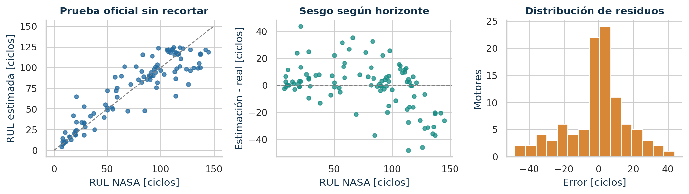

# Predicción de Vida Útil Remanente en Motores Turbofán

Universidad Don Bosco · DAS172 · Docente: Eduardo Galicia · 4 de noviembre de 2026

Integrantes: Salazar Guzmán, Adriana Zaira (SG231489); Martínez Linares, Marcela Lorena (ML220036); Mejía Martínez, Andrea Alejandra (MM210136); Hernández Martínez, Diego Josué (HM240091); Abarca Gómez, Mauro José (AG241380); Portillo Linares, Jaime Fernando (PL231163).

## 1. Problema, alcance y datos

### Resumen ejecutivo

Se desarrolló un sistema reproducible para estimar la vida útil remanente (RUL) de turbofanes simulados mediante NASA C-MAPSS FD001. La selección se realizó con validación cruzada agrupada por motor y la incertidumbre se calibró con unidades reservadas. El modelo RandomForest_leaf3 obtuvo RMSE de 17.19 ciclos, MAE de 12.33 ciclos y R² de 0.829 en 100 motores oficiales, sin recortar su verdad de referencia. La cobertura observada del intervalo nominal de 90% fue 100.0%.

### 1.1. Pregunta de ingeniería y objetivos

¿Puede la telemetría multivariable ordenar prioridades de revisión del compresor de alta presión (HPC) antes del límite de vida simulado? El objetivo general es construir y evaluar una estimación de RUL que apoye escenarios de inspección boroscópica. Los objetivos específicos son validar la calidad física de los registros, contrastar tendencias por motor, comparar modelos sin fuga y convertir la estimación y su incertidumbre en una decisión trazable.

El uso de RUL responde a una necesidad de mantenimiento basado en condición: anticipar deterioro y preparar recursos para disminuir exposición a paradas no programadas (AOG). El dataset no contiene eventos AOG, inspecciones, costos ni decisiones de mantenimiento; por tanto, el proyecto no estima un ahorro real ni demuestra que una política reduzca AOG. La priorización es un escenario de ingeniería explícito.

### 1.2. Fuente, población y alcance físico [1-3]

| Elemento | Contenido verificado |
| --- | --- |
| Origen | NASA Ames PCoE; descarga desde el enlace publicado por NASA. TXT originales y SHA-256 incluidos. |
| Entrenamiento | 20,631 filas; 100 motores hasta el fallo. |
| Prueba oficial | 13,096 filas; 100 motores truncados y 100 RUL verdaderas del último ciclo. |
| Esquema | 26 columnas: ID, ciclo, 3 ajustes y 21 canales de sensores. |
| FD001 | Una condición operacional (nivel del mar) y un modo de fallo: degradación del HPC. |
| Unidad de análisis | Motor independiente; cada fila es una observación de ciclo simulado. |

FD001 representa pérdida progresiva de capacidad de flujo y eficiencia del HPC dentro de una simulación termodinámica con control y ruido. La respuesta de temperatura, presión y caudal puede revelar esa degradación, pero una asociación predictiva no identifica daño de un álabe ni demuestra una relación causal. FD001 no es un conjunto de fallos de turbina de alta presión (HPT).

No se equipara un ciclo del simulador a una hora de vuelo ni se extrapolan los resultados a todas las condiciones de misión. Los ajustes operacionales se conservan como canales nativos; no se les asignan altitud o Mach con unidades que el TXT no documenta de forma inequívoca.

## 2. ETL y consistencia física

### 2.1. Integridad antes del modelado

La ingesta lee separadores de espacio y exige exactamente 26 columnas numéricas. Se conserva una copia inmutable en data/raw. El origen y el SHA-256 de cada TXT constan en provenance.json. Se comprueban ID y ciclo enteros positivos, clave motor-ciclo única, inicio en ciclo 1 y continuidad temporal. Un duplicado o un hueco provoca un error visible; no se elimina silenciosamente.

| Control | Train | Test |
| --- | --- | --- |
| Nulos originales | 0 | 0 |
| Claves duplicadas | 0 | 0 |
| Valores no finitos | 0 | 0 |
| Sensores no positivos | 0 | 0 |
| Huecos entre ciclos | 0 | 0 |
| Filas descartadas | 0 | 0 |

### 2.2. Unidades y plausibilidad [3, tabla 2]

| Canales | Magnitud | Conversión determinista |
| --- | --- | --- |
| s1-s4 | Temperatura absoluta | K = °R × 5/9; no se resta 273.15. |
| s5,s6,s7,s11 | Presión absoluta | kPa abs = psia × 6.894757293168. |
| s12 (phi) | Flujo / presión | (kg/s)/kPa = (lbm/s)/psi × 0.45359237 / 6.894757293168. |
| s20,s21 | Flujo de sangrado | kg/s = lbm/s × 0.45359237. |
| s8,s9,s13,s14,s18 | Velocidad | rpm conservadas. |
| s10,s15,s16; s17,s19 | Ratios / canales nativos | Ratios sin dimensión. s17 y s19 conservan escala nativa por ambigüedad de unidad. |

Las presiones se mantienen absolutas. No se convierten a manométricas restando una atmósfera arbitraria. Una temperatura absoluta, presión o canal positivo no puede ser ≤0 en este esquema; esos valores o los no finitos se marcan faltantes. Son verificaciones mínimas de consistencia, no envolventes completas de operación certificadas.

### 2.3. Nulos y atípicos: tratar causas sin borrar deterioro

Los límites descriptivos Q1-3·IQR y Q3+3·IQR se calculan solo en desarrollo: se señalan 1194 celdas, con cero eliminaciones por ser extremos estadísticos. Cerca del fallo, un extremo puede contener la señal objetivo. El paquete incluye la auditoría por canal y las columnas constantes detectadas. No se crean nulos artificiales para aparentar limpieza.

El imputador de mediana aprende únicamente con las filas del ajuste en cada fold; los faltantes del resto se transforman con esas mismas medianas. Los valores iniciales sin desviación estándar o pendiente suficiente se dejan como NaN hasta ese paso. El selector de varianza y StandardScaler también se ajustan dentro del fold. Las conversiones SI son fórmulas fijas y no aprenden estadísticas poblacionales.

## 3. Diseño del experimento sin fuga

### 3.1. Objetivos y características causales

Para un motor i de entrenamiento que termina en el ciclo Ti, se define RULi,t=Ti-t. La etiqueta de ajuste es yi,t=min(RULi,t,125). La meseta representa menor observabilidad del daño inicial y limita la exigencia de diferenciar vidas lejanas. El valor 125 es un hiperparámetro fijado antes de evaluar; no es una constante física de fallo. La prueba y la CV se comparan con la RUL verdadera sin recortar.

Se construyen 130 características: edad en ciclos; 3 ajustes; 21 sensores actuales; medias por sensor en ventanas de 5, 15 y 30 ciclos; desviación estándar y pendiente lineal en 15 ciclos. Todas las ventanas terminan en t, usan solo el mismo motor y admiten historial parcial. Se excluyen ID, vida total, ciclos futuros y etiquetas. La prueba de perturbación del futuro verifica esta propiedad.

```text
X(t) usa {x(u): u <= t, mismo motor}
fit_transform: solo fold de ajuste
transform: validación, calibración y prueba
```

### 3.2. Partición independiente y protocolo fijado [4]

| Etapa | Motores | Uso permitido |
| --- | --- | --- |
| Desarrollo | 80 de train_FD001 | Selección con GroupKFold: 5 folds, 64 motores de ajuste y 16 de validación en cada fold. |
| Calibración | 20 restantes de train_FD001 | Un punto pseudo-censurado por motor; solo estima el radio de incertidumbre. |
| Prueba externa | 100 de test_FD001 | Solo inferencia; el vector NASA se abre tras congelar el modelo. |

La reserva de calibración se sortea por ID con semilla 42. Se elige un punto pseudo-censurado uniforme por motor entre ciclos ≥30 previos al fallo, con semilla 43, sin consultar longitudes ni etiquetas de prueba. Esa muestra evita validar exclusivamente RUL=0 al final de las trayectorias completas. Los mismos puntos y folds se usan para todos los candidatos. Las identidades se distinguen como train:ID y test:ID porque NASA reutiliza los enteros entre flotas independientes.

GroupKFold se baraja con semilla 42 y mantiene todas las filas de cada motor en un único lado. Cada candidato crea un Pipeline nuevo: mediana → varianza >10-12 → StandardScaler → regresor. La ponderación total es igual por motor, evitando que trayectorias largas dominen la pérdida. El RMSE medio de los cinco folds define el ganador; la desviación entre folds describe su variabilidad.

Se reajusta el candidato elegido en los 80 motores de desarrollo y se calibra con los 20 reservados, sin incorporarlos después al ajuste. Se serializan predictor, transformadores y metadatos antes de consultar las etiquetas oficiales. La curva de aprendizaje utiliza un fold de desarrollo y nunca la calibración o la prueba. El CV sirve para selección; su media no se presenta como evaluación final insesgada después de seleccionar.

## 4. EDA y contraste estadístico

El EDA se limita a los 80 motores de desarrollo (16,390 ciclos). Las vidas observadas tienen mínimo 128, mediana 199.0 y máximo 341 ciclos. Esta heterogeneidad respalda agrupar por unidad y evita asumir una vida fija del motor. Las trayectorias suavizadas muestran tendencias con ruido y diferencias entre unidades.



### 4.1. Hipótesis y unidad independiente

Para cada canal predefinido se calcula una diferencia por motor: media de los últimos 30 ciclos menos media de los primeros 30. Se aplica Wilcoxon bilateral de rangos con signo: H0, distribución de diferencias simétrica alrededor de cero; su interpretación como contraste de localización requiere simetría. Se usa Holm para controlar el error familiar de ocho pruebas (α=0.05). El efecto es la correlación biserial de rangos con signo; el IC95% de la media se obtiene remuestreando motores 2 000 veces.

| Canal | Δ media (SI) | IC95% media | p Holm | Efecto |
| --- | --- | --- | --- | --- |
| s2 / T24 | 0.558 | [0.533; 0.584] | 6.28e-14 | 1.000 |
| s3 / T30 | 6.641 | [6.350; 6.947] | 6.28e-14 | 1.000 |
| s4 / T50 | 11.251 | [10.782; 11.697] | 6.28e-14 | 1.000 |
| s7 / P30 | -13.311 | [-13.959; -12.596] | 6.28e-14 | -1.000 |
| s11 / Ps30 | 4.257 | [4.056; 4.455] | 6.28e-14 | 1.000 |
| s12 / phi | -0.107 | [-0.113; -0.102] | 6.28e-14 | -1.000 |
| s20 / W31 | -0.172 | [-0.179; -0.164] | 6.28e-14 | -1.000 |
| s21 / W32 | -0.104 | [-0.108; -0.099] | 6.28e-14 | -1.000 |

Los cambios conjuntos de temperatura, presión y flujo son compatibles con la degradación del HPC bajo el controlador simulado. El tamaño de efecto y las unidades complementan el valor p: significancia no implica por sí sola utilidad predictiva. Las ventanas tempranas y tardías se definen con la trayectoria completa únicamente para este contraste retrospectivo; no entran como predictores ni como normalización del modelo.

La matriz Spearman completa se entrega en CSV y figura. Es descriptiva: sus filas son ciclos correlacionados y no se le atribuyen p-valores independientes. La colinealidad entre sensores y ventanas obliga a interpretar la importancia del modelo con cautela. Los canales constantes se eliminan mediante un selector ajustado dentro de cada fold, sin usar su comportamiento en prueba.

## 5. Modelado y selección

### 5.1. Fundamento y espacio de búsqueda

La mediana proporciona una referencia sin telemetría; Ridge regulariza una relación lineal multivariable; Random Forest captura interacciones mediante agregación de árboles; XGBoost aproxima relaciones no lineales por boosting regularizado. Los ocho candidatos se fijaron antes de la prueba: mediana; Ridge α={10,100}; bosques de 180 árboles con hoja mínima {3,8}; XGBoost con profundidad/árboles {(3,450),(4,450),(4,700)}. [5]

XGBoost usa tasa 0.035, min_child_weight=8, subsample=0.85, colsample_bytree=0.85, λ=10, α L1=0.2 y entrenamiento histogram. Los bosques usan max_features=0.75. Semilla 42 y dos hilos. No se aplica parada temprana con prueba ni se tunea la meseta después de ver el resultado oficial. Se recortan predicciones negativas a cero; no se impone un techo de 125 a las predicciones.

| Candidato | RMSE CV [ciclos] | DE folds | MAE CV |
| --- | --- | --- | --- |
| RandomForest_leaf3 | 31.84 | 10.04 | 21.78 |
| RandomForest_leaf8 | 32.20 | 9.84 | 21.97 |
| XGBoost_d4_n700 | 32.36 | 10.56 | 21.79 |
| XGBoost_d4_n450 | 32.60 | 10.54 | 22.05 |
| XGBoost_d3_n450 | 32.69 | 10.29 | 22.50 |
| Ridge_a10 | 34.19 | 9.40 | 24.32 |
| Ridge_a100 | 34.39 | 9.34 | 24.59 |
| Median_baseline | 54.03 | 9.09 | 42.45 |



Se eligió RandomForest_leaf3, con RMSE CV medio 31.84 ± 10.04 ciclos. La curva utiliza 16, 32, 48 y 64 motores de un fold, manteniendo fija su validación. En el extremo de 64 motores se observa RMSE de ajuste 27.27 y validación 32.78. Su brecha debe leerse junto con la variabilidad del CV; una única curva no prueba convergencia poblacional.

La CV usa pseudo-censura uniforme y puede incluir horizontes mayores que NASA; sus RMSE no son directamente intercambiables y la meseta influye en los errores lejanos. Las importancias internas, entregadas en figura y CSV, reparten peso entre variables correlacionadas y no son efectos causales. La prueba externa congelada sustenta la evaluación final.

## 6. Desempeño e incertidumbre

### 6.1. Evaluación oficial por último ciclo [2,3]

| Métrica principal | Resultado |
| --- | --- |
| RMSE [ciclos] | 17.19 |
| MAE [ciclos] | 12.33 |
| R² | 0.829 |
| Sesgo, estimación - verdad [ciclos] | -0.50 |
| NASA score; menor es mejor | 491.73 |
| IC95% bootstrap RMSE [ciclos] | [14.35; 19.80] |
| Cobertura / ancho medio intervalo 90% | 100.0% / 172.76 ciclos |

RMSE = raíz de la media de errores cuadrados; MAE = media del error absoluto; R² compara con la media de la verdad. Para d=RUL estimada-RUL real, NASA score suma exp(-d/13)-1 si d<0 y exp(d/10)-1 si d≥0. Así penaliza más una sobreestimación peligrosa. El IC del RMSE remuestrea 100 motores independientes, no ciclos, y no cubre la incertidumbre de reentrenar el modelo.



### 6.2. Calibración reservada y límites de interpretación [6]

Con 20 motores de calibración se ordenan |y-ŷ| y se toma el estadístico de orden ceil((20+1)·0.9)=19. El radio obtenido es 101.74 ciclos; el intervalo es [max(0,ŷ-q), ŷ+q]. La cobertura empírica oficial es 100.0%, que se comunica junto con su ancho en lugar de asumir el 90% nominal.

La amplitud de la banda limita su utilidad: con el escenario por defecto, 78 motores requieren revisión prioritaria, 22 planificación y 0 seguimiento. La cobertura alta no implica buen poder de discriminación. No se cambió el protocolo para estrechar la banda tras observar la prueba.

La validez conformal marginal requiere motores intercambiables y el mismo mecanismo de muestreo del punto observado. Nuestra pseudo-censura uniforme no garantiza coincidir con el protocolo NASA: el cambio de distribución y el tamaño de calibración limitan el traslado de la garantía. El intervalo no asegura 90% para un motor concreto ni para toda su trayectoria. Los ciclos menores a 30 quedan fuera del protocolo de calibración.

Como análisis secundario, al limitar también la verdad a 125 el RMSE es 15.87 ciclos. No se sustituye con esa cifra el RMSE oficial 17.19. La meseta y la menor observabilidad inicial pueden sesgar los horizontes largos; se entregan errores por horizonte y motor.

## 7. Priorización de inspección

### 7.1. Regla operativa demostrativa, fijada antes de prueba

La estimación no se convierte automáticamente en una fecha de fallo. Se propone usar el límite inferior L del intervalo para priorizar una revisión por ingeniería. El horizonte H=30 ciclos, reserva B=10 y máximo de reevaluación M=20 son supuestos configurables del escenario, no parámetros derivados del fabricante.

| Condición | Salida | Acción de planificación |
| --- | --- | --- |
| L ≤ B | Revisión prioritaria | Solicitar evaluación de ingeniería; no diferir por esta herramienta. |
| B < L ≤ H+B | Planificar inspección | Reservar ventana y recursos para revisión del HPC. |
| L > H+B | Seguimiento | Mantener monitoreo y reevaluar con nueva telemetría. |

```text
Presupuesto de reevaluación = floor(min(M, max(0, L-B)))
Con H=30, B=10 y M=20: decisión conservadora de escenario.
```

Este presupuesto expresa cuándo volver a analizar datos; no autoriza operación hasta ese instante ni reemplaza intervalos OEM, tareas del programa aprobado o decisiones de aeronavegabilidad. Una banda ancha puede generar muchas alertas y demanda de inspección. El tablero muestra esa carga de trabajo al cambiar horizonte y reserva.

### 7.2. Sensibilidad de alertas, sin modificar el modelo

| H [ciclos] | TP / FP / FN / TN | Recall | Precisión | Costo ilustrativo |
| --- | --- | --- | --- | --- |
| 15 | 10 / 90 / 0 / 0 | 1.000 | 0.100 | 90 |
| 30 | 25 / 75 / 0 / 0 | 1.000 | 0.250 | 75 |
| 45 | 28 / 72 / 0 / 0 | 1.000 | 0.280 | 72 |

Un caso se considera urgente cuando la RUL verdadera ≤H; una alerta se activa cuando L≤H+10. TP es urgente alertado, FP alerta sin urgencia, FN urgencia no alertada y TN ausencia correcta de alerta. La pérdida FP+20·FN asigna 20 veces más costo a una omisión, en unidades arbitrarias. Es sensibilidad retrospectiva de la regla prefijada, no una optimización del umbral sobre prueba ni una demostración de rentabilidad.

### 7.3. Ejemplos concretos de la flota de prueba

| Motor | Ciclo | RUL estimada | Límite inferior | Reevaluar ≤ |
| --- | --- | --- | --- | --- |
| 4 | 106 | 95.1 | 0.0 | 0 ciclos |
| 3 | 126 | 47.2 | 0.0 | 0 ciclos |
| 85 | 34 | 124.2 | 22.4 | 12 ciclos |
| 1 | 31 | 124.5 | 22.8 | 12 ciclos |

La app ofrece filtros de estado, selección por motor y ciclo, sensores con unidades, banda de incertidumbre, comparación de modelos, trazabilidad y exportación CSV. Un historial cargado debe contener todos los ciclos desde el primero y el esquema nativo NASA; una entrada inválida se rechaza con un mensaje. Las métricas oficiales se mantienen identificadas como evaluación de NASA, sin atribuirlas a un CSV nuevo.

## 8. Software, reproducción y trazabilidad

### 8.1. Arquitectura modular y contrato de ejecución

| Módulo / artefacto | Responsabilidad |
| --- | --- |
| src/rul/data.py | Descarga, SHA-256, esquema, validaciones físicas y conversiones SI. |
| features.py / modeling.py | Ventanas causales; candidatos; Pipeline de preprocesamiento local al fold. |
| pipeline.py / evaluation.py | CV por motor, selección, calibración, serialización, métricas y decisión. |
| analysis.py / inference.py | EDA y pruebas por unidad; predicción sin acceso a etiquetas. |
| app.py / notebooks/ | Streamlit interactivo y notebook ejecutado desde datos originales. |
| models/ / reports/ | Modelo y metadatos; métricas, manifiestos, tablas, figuras y reporte. |

Entorno verificado: CPython 3.12.14. requirements.txt fija las versiones exactas de todas las dependencias directas; el archivo lock registra las transitivas. Se ejecuta desde la raíz con rutas relativas. Los datos y el modelo entrenado incluidos permiten usar la app sin descargar ni entrenar. La reproducción desde cero vuelve a verificar SHA-256 y recrea todos los derivados.

```bash
python -m venv .venv
# Activar .venv según el sistema
python -m pip install -r requirements-lock.txt
python scripts/run_pipeline.py
python scripts/execute_notebook.py
python scripts/build_report.py
python -m pytest -q
streamlit run app.py
```

El pipeline y el notebook son dos rutas equivalentes de reproducción completa: no es necesario ejecutar ambas para obtener resultados. El ejecutor del notebook usa el intérprete activo; los scripts no contienen rutas del equipo de desarrollo. Se incluyen guía de inicio, diccionario y guion de defensa individual. El pickle se carga únicamente desde el artefacto de confianza generado por el proyecto, nunca desde una carga de usuario.

### 8.2. Evidencia contra descalificación y cobertura de rúbrica

| Criterio | Evidencia verificable |
| --- | --- |
| ETL · 20% | data_audit.json, provenance.json, outlier_audit.csv, pruebas de esquema y unidades. |
| EDA · 25% | Hipótesis por motor, Holm, IC bootstrap, Spearman descriptivo y trazas temporales. |
| Modelado · 25% | cv_results.csv, split_manifest.json, modelo congelado, métricas oficiales y residuos. |
| Interactividad · 15% | AppTest de carga y filtros; motor, ciclo, escenario, sensores, CSV y Plotly. |
| Contexto / reporte · 15% | Decisión con límite inferior, sensibilidad, límites físicos y reporte de 10 páginas. |

Las pruebas verifican invariancia de características al perturbar el futuro, no solapamiento de motores, estadísticas de escalado calculadas solo en desarrollo, congelación del modelo, persistencia de predicciones y correspondencia exacta con el vector NASA. El paquete incluye el registro de ejecución y verificación. Estas evidencias facilitan la evaluación; la calificación final depende del docente y de la defensa individual.

## 9. Conclusiones y referencias

### 9.1. Conclusiones sustentadas

1. El flujo completo ejecutado conserva independencia por motor y preprocesamiento local al ajuste. El modelo RandomForest_leaf3, elegido entre ocho candidatos por CV, alcanzó RMSE 17.19 ciclos, MAE 12.33 y NASA score 491.73 en la prueba externa de 100 motores. Estas cifras describen FD001; no certifican precisión en motores comerciales reales.

2. El EDA por unidad identifica diferencias térmicas y de flujo asociadas al deterioro simulado. El contraste usa ocho hipótesis con Holm y efectos por motor, evitando inflar la significancia mediante ciclos correlacionados. Las correlaciones e importancias complementan el análisis sin constituir pruebas de causalidad.

3. La incertidumbre se calibra sin reutilizar motores de ajuste: radio 101.74 ciclos, cobertura oficial 100.0% y ancho medio 172.76 ciclos. La cobertura marginal, la censura y el tamaño de calibración deben condicionar cualquier interpretación de riesgo individual.

4. La política basada en límite inferior traduce RUL a prioridades revisables y permite observar falsas alertas y omisiones. El proyecto entrega una herramienta de análisis y planificación de escenarios, no un calendario de mantenimiento aprobado ni evidencia de reducción de AOG.

### 9.2. Limitaciones y trabajo futuro

La muestra es pequeña a nivel de motores, sintética y de un único régimen y modo de fallo. La meseta de 125 reduce resolución a horizontes largos; los errores de motores tempranos pueden ser mayores. Las ventanas y algoritmos no prueban todas las arquitecturas posibles. La selección puede beneficiarse de validación agrupada anidada o repeticiones con presupuesto mayor; el resultado externo actual permanece intacto. Se propone evaluar otras particiones con nuevos datos, FD002/FD004, calibración con censura operacional equivalente, modelos de supervivencia y ensayos de campo que midan carga de inspecciones, AOG y costo con un diseño causal.

### 9.3. Referencias primarias y trazabilidad documental

[1] NASA Ames PCoE. Saxena, A. y Goebel, K. (2008). Turbofan Engine Degradation Simulation Data Set. Fuente y enlace de descarga: https://www.nasa.gov/intelligent-systems-division/discovery-and-systems-health/pcoe/pcoe-data-set-repository/

[2] NASA Open Data. CMAPSS Jet Engine Simulated Data. Descripción de las flotas, FD001 y etiquetas: https://data.nasa.gov/dataset/cmapss-jet-engine-simulated-data

[3] Saxena, A.; Goebel, K.; Simon, D.; Eklund, N. (2008). Damage Propagation Modeling for Aircraft Engine Prognostics. NTRS 20090029214; tabla 2 (canales) y ec. 9 (score): https://ntrs.nasa.gov/citations/20090029214

[4] scikit-learn. Documentación oficial: validación agrupada y prevención de data leakage. Versión de ejecución 1.8.0. https://scikit-learn.org/1.8/modules/cross_validation.html

[5] XGBoost. Documentación oficial de la API Python; versión del artefacto 3.4.1. https://xgboost.readthedocs.io/en/stable/python/python_api.html

[6] Angelopoulos, A. N. y Bates, S. (2021; revisión 2022). A Gentle Introduction to Conformal Prediction and Distribution-Free Uncertainty Quantification. arXiv:2107.07511. https://arxiv.org/abs/2107.07511

[7] Streamlit. Documentación oficial de AppTest para verificación del tablero. https://docs.streamlit.io/develop/api-reference/app-testing/st.testing.v1.apptest

Documentos de la asignatura: Rúbrica de Proyecto: Análisis de Datos Aeronáuticos (8 páginas) y Reporte_Tecnico_Aerodinamica.pdf (portada modelo facilitada). Se conserva la portada con docente, integrantes y carnés; solo se adapta el tema y la fecha. Fuentes consultadas el 4 de noviembre de 2026. Código del proyecto redactado para esta entrega; no se reutilizaron notebooks públicos.
